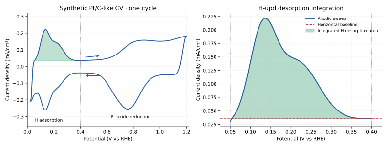
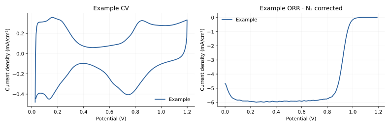

# PEMFC Electrocatalyst Activity Analyzer

Offline **CV / ORR analysis** for catalyst R&D: ECSA, mass activity, specific activity, QC, multi-sample comparisons and multi-rpm Koutecký–Levich fitting.

**[Open the workbench](https://andypeng09.github.io/PEMFC-Electrocatalyst-Activity-Analyzer/)** · **[Download the latest release HTML](https://github.com/ANDYPENG09/PEMFC-Electrocatalyst-Activity-Analyzer/releases/latest/download/index.html)** · [Releases](https://github.com/ANDYPENG09/PEMFC-Electrocatalyst-Activity-Analyzer/releases) · [Methods and export schema](docs/methods-and-exports.md)

**v1.4.1** introduces a glass workspace with section navigation and responsive layouts. Open the self-contained `index.html` in a browser to work offline in English or 中文.

### How H-upd ECSA is calculated



The selected cycle's **anodic** sweep supplies the H-desorption curve. The green area is the positive current above the baseline between the integration limits (0.05–0.40 V vs RHE by default). Choose the upper-limit horizontal baseline, a manual horizontal baseline, or a manual sloped baseline defined by its current densities at both limits. Divide that area by scan rate to obtain charge, then divide by the H-upd reference charge and Pt loading. Select the limits and background using the experimental protocol.

This figure uses the same anonymized **Example** CV data as the single-sample calculator. The data are an example, not a universal catalyst fingerprint or a performance claim. The reference electrode, scan rate, loading, baseline and integration limits must be verified for each experiment.

### Example CV and ORR



*The ORR curve subtracts the N₂ background over the shared potential range and uses the calculator's seven-point smoothing. The separate two-sample workbench demo is synthetic.*

## Applications and quality support

The companion [Technical Support & Quality Workbench](technical-support/README.md) reviews analyzer exports, checks test context and user-entered specifications, documents troubleshooting hypotheses, and prepares a bilingual report. [Open the support workbench](https://andypeng09.github.io/PEMFC-Electrocatalyst-Activity-Analyzer/technical-support/).

## Start in one minute

1. Open the workbench or save and open `index.html` locally.
2. Click **Load Example Data** for the original calculators, or **Load two-sample demo** in the Analysis Workbench.
3. For your data, fill CV and O₂/N₂ LSV, confirm current units, scan rate, Pt loading and potential reference. Give each sample a unique name and click **Analyze & add current sample**.
4. Select samples to compare. Inspect QC explanations before interpreting metrics; choose which CV/LSV panels to export.
5. Download results/curve points with `summary.csv`, analysis with JSON, and raw samples/settings with **Back up history**.

History is stored in the current browser. JSON backup is the portable copy to keep before moving the HTML, changing browsers or clearing storage.

## What it includes

| Task | Result |
|---|---|
| H-upd CV integration | ECSA with baseline and integration-bound settings |
| O₂/N₂ LSV | Background subtraction, automatic plateau detection, E½, MA/SA and Tafel diagnostics |
| Quality checks | Explained Good / Check recommended / Invalid status |
| Multi-sample workflow | Naming, history, restore inputs, CV/LSV overlays and selective figures |
| Multi-rpm K–L | Signed fit, R², kinetic current; optional n with supplied electrolyte constants |
| Exports | Exact plotted points, per-sample metrics, units, settings and QC |
| Existing Python utilities | Pine AfterMath `.paax`, Origin `.opju`, formulas and plotting |

The workbench does not silently substitute `min(j)` for a diffusion plateau. QC thresholds are screening heuristics; they do not certify standards compliance. ECSA is a method-dependent estimate, and transport-limited activity estimates need review.

## Python and validation

```bash
pip install -r requirements.txt
python run_analysis_example.py --plot
python -m unittest discover -s tests -v
python build_html.py --check
npm ci
npm test
```

Edit maintained workbench files in `web/`, then run `python build_html.py` and commit the rebuilt HTML. CI repeats the numerical, JS/Python parity, DOM and build-consistency checks on pushes and pull requests. DOM tests mock canvas/image I/O; they are not browser-pixel tests.

The existing Pages site publishes the separate `gh-pages` branch. After validation, synchronize `index.html` from the reviewed source commit to that branch and record the source SHA in `commit.txt`. Updating `main` alone does not update the live site. Keep the existing Pages source and visibility settings.

## Connect analysis to experiment planning

Join `results.csv` to an experimental-design table by `sample_id`, retaining QC and units. See [BO handoff](docs/bo-handoff.md). The companion [BO planner](https://github.com/ANDYPENG09/bayesian-optimization-electrocatalyst) filters `Invalid` results and forecasts constraint feasibility; synthetic examples demonstrate the interface.

[Changelog](CHANGELOG.md) · [MIT License](LICENSE) · Author: [Yu Peng](https://github.com/ANDYPENG09)

### v1.3.0 — independent LSV input clearing

**Clear O₂ LSV** preserves N₂ background data for reuse. **Clear N₂ Background** preserves the O₂ LSV data. Both actions clear the previous corrected plot and ORR results; run extraction again after updating the input. Restoring a saved sample replaces both inputs with that sample’s saved data.

### Direct PAAX import

Open **Import Pine AfterMath PAAX**, choose a `.paax` file, and select the test run and curve. The picker hides auxiliary time traces and exact copies from the same experiment. With recorded times, it groups the traces in the order activation CV → ECSA CV → N₂ LSV → O₂ LSV, opening the most recent run by default. For the default workflow, CVs at up to 30 mV/s are grouped as ECSA and those at 75 mV/s or above as activation. Other CVs remain selectable. The LSV classifier uses the median current in the low-potential region, a cathodic plateau and the current drop at higher potential, then compares compatible potential windows to identify low-current backgrounds. Gas labels are used when current evidence is inconclusive. Unclassified LSVs allow either destination. The selected data are imported in acquisition order and converted to V/A. Check the scan rate, reference and Pt loading before calculation.

For a multi-cycle CV, select the cycle beside the CV input. The browser defaults to cycle 2 and uses the original segment boundaries when available. If the chosen cycle lacks coverage, review its measured range or choose another cycle. The default endpoint adjustment allows each requested endpoint to move inward by at most one local sampling step and 5 mV. Results show the actual limits and preserve the requested settings. Turn this option off for a fixed window. Use the same effective window when comparing ECSA across samples.
